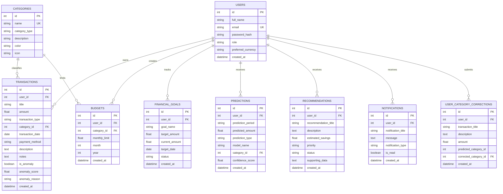

# Database Design & Schema Architecture

## 1. Entity-Relationship Overview

The database design provides strict data isolation by `user_id`, relational integrity, cascading deletion, and indexed columns for fast time-series queries.

---

## 2. Table Specifications

### A. `users`
| Column | Type | Constraints | Description |
|---|---|---|---|
| `id` | `INTEGER` | Primary Key, Auto Increment | Unique user identifier |
| `full_name` | `VARCHAR(100)` | Not Null | User's full name |
| `email` | `VARCHAR(255)` | Unique, Indexed, Not Null | User's login email |
| `password_hash` | `VARCHAR(255)` | Not Null | Bcrypt salted hash |
| `role` | `VARCHAR(20)` | Default 'user', Not Null | 'user' or 'admin' |
| `preferred_currency` | `VARCHAR(10)` | Default 'INR', Not Null | ISO currency code (INR, USD, EUR, etc.) |
| `created_at` | `DATETIME` | Default UTC now | Registration timestamp |

### B. `categories`
| Column | Type | Constraints | Description |
|---|---|---|---|
| `id` | `INTEGER` | Primary Key, Auto Increment | Category ID |
| `name` | `VARCHAR(50)` | Unique, Indexed, Not Null | Category name (Food, Utilities, etc.) |
| `category_type` | `VARCHAR(20)` | Default 'expense', Not Null | 'expense' or 'income' |
| `description` | `VARCHAR(255)` | Nullable | Scope description |
| `color` | `VARCHAR(20)` | Default '#6366f1' | Hex accent color for charts |
| `icon` | `VARCHAR(50)` | Default 'Tag' | Lucide icon identifier |

### C. `transactions`
| Column | Type | Constraints | Description |
|---|---|---|---|
| `id` | `INTEGER` | Primary Key, Auto Increment | Transaction ID |
| `user_id` | `INTEGER` | Foreign Key (`users.id` ON DELETE CASCADE), Indexed | User ownership |
| `title` | `VARCHAR(150)` | Not Null | Merchant / Title / Narration |
| `amount` | `FLOAT` | Not Null | Transaction monetary amount |
| `transaction_type` | `VARCHAR(20)` | Not Null | 'expense' or 'income' |
| `category_id` | `INTEGER` | Foreign Key (`categories.id` ON DELETE SET NULL), Indexed | Associated category |
| `transaction_date` | `DATE` | Indexed, Not Null | Date of transaction |
| `payment_method` | `VARCHAR(50)` | Default 'UPI' | UPI, Credit Card, Cash, etc. |
| `description` | `TEXT` | Nullable | Additional particulars |
| `notes` | `TEXT` | Nullable | User private notes |
| `is_anomaly` | `BOOLEAN` | Default False | Flagged as unusual transaction |
| `anomaly_score` | `FLOAT` | Default 0.0 | Normalized outlier score (0.0 - 1.0) |
| `anomaly_reason` | `VARCHAR(255)` | Nullable | Human-readable explanation |
| `created_at` | `DATETIME` | Default UTC now | Row creation timestamp |

### D. `budgets`
| Column | Type | Constraints | Description |
|---|---|---|---|
| `id` | `INTEGER` | Primary Key, Auto Increment | Budget ID |
| `user_id` | `INTEGER` | Foreign Key (`users.id` ON DELETE CASCADE), Indexed | User ownership |
| `category_id` | `INTEGER` | Foreign Key (`categories.id` ON DELETE CASCADE), Indexed | Budgeted category |
| `monthly_limit` | `FLOAT` | Not Null | Ceiling spend amount for month |
| `month` | `INTEGER` | 1-12, Not Null | Month number |
| `year` | `INTEGER` | Not Null | Target year |
| `created_at` | `DATETIME` | Default UTC now | Created timestamp |

### E. `financial_goals`
| Column | Type | Constraints | Description |
|---|---|---|---|
| `id` | `INTEGER` | Primary Key, Auto Increment | Goal ID |
| `user_id` | `INTEGER` | Foreign Key (`users.id` ON DELETE CASCADE), Indexed | User ownership |
| `goal_name` | `VARCHAR(150)` | Not Null | Goal description |
| `target_amount` | `FLOAT` | Not Null | Target capital to reach |
| `current_amount` | `FLOAT` | Default 0.0 | Accumulated savings |
| `target_date` | `DATE` | Not Null | Milestone target date |
| `status` | `VARCHAR(30)` | Default 'in_progress' | 'in_progress', 'achieved', 'cancelled' |
| `created_at` | `DATETIME` | Default UTC now | Created timestamp |

---

## 3. Database Indexes & Optimization

1. **`users(email)`**: Unique index for constant-time credential lookups during login.
2. **`transactions(user_id, transaction_date)`**: Composite index for fast longitudinal aggregations and date-range filters.
3. **`budgets(user_id, month, year, category_id)`**: Composite index for instant monthly utilization resolution.
4. **`transactions(category_id)`**: Foreign key index for category-level rollups.
