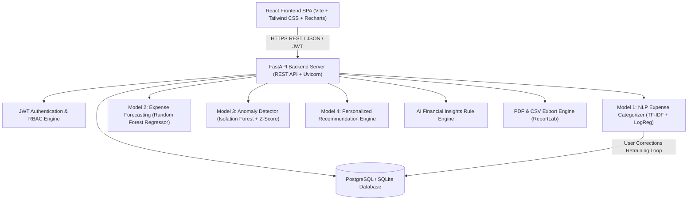

# System Architecture

## 1. System Overview

The **AI-Powered Personal Finance Management and Expense Prediction System** is an advanced, production-grade web application built to help individuals manage personal finances, track multi-account cash flows, detect anomalies, forecast future monthly and weekly expenses using machine learning, and receive personalized savings recommendations.

---

## 2. Key Architectural Layers

### A. Presentation Layer (Frontend)
- **Framework**: React.js 18 with Vite.
- **Styling**: Tailwind CSS with custom typography (`Plus Jakarta Sans`) and full light/dark theme support.
- **Visualizations**: Interactive charts powered by Recharts (Bar, Line, Area, and Donut charts).
- **State & Context**: Context API for global `AuthContext` (JWT session management) and `ThemeContext`.
- **API Communication**: Axios with interceptors for automatic JWT injection and unified 401 unauthenticated redirect handling.

### B. Application Layer (Backend)
- **Framework**: FastAPI (Python 3.10+ / 3.14).
- **ASGI Server**: Uvicorn.
- **Security**: OAuth2 Password Bearer flow, JWT tokens (HS256), and password hashing via modern Bcrypt.
- **Validation**: Strict Pydantic v2 schemas for all inputs and responses.
- **Access Control**: Role-based access control (User vs. Administrator).

### C. Data Persistence Layer (Database)
- **ORM**: SQLAlchemy 2.0 with Declarative Base.
- **Engines Supported**:
  - Primary production: **PostgreSQL** via `psycopg2-binary`.
  - Zero-config local development: **SQLite** via `sqlite:///./finance.db`.
- **Integrity**: Foreign keys with `CASCADE` and `SET NULL` actions, unique indexes on user emails and category names, chronological indexes on transaction dates.

### D. Machine Learning & Predictive Layer
- **Scikit-Learn & Joblib**: Pretrained persistent model artifacts saved in `ml/saved_models/`.
- **Model 1 (Categorization)**: TF-IDF n-gram vectorizer with balanced multi-class Logistic Regression.
- **Model 2 (Forecasting)**: Multi-feature Random Forest Regressor incorporating rolling 3-month moving averages, historical lag features, seasonal monthly parameters, and transaction frequencies.
- **Model 3 (Anomaly Detection)**: Isolation Forest and statistical category Z-scores.
- **Model 4 (Recommendation Engine)**: Algorithmic discretionary creep analysis, subscription auditor, and budget threshold tracking.

---

## 3. Data Flow & Lifecycles

### Transaction Lifecycle
1. **Creation**: User creates a transaction manually or uploads a bank statement CSV.
2. **Auto-Categorization**: If no category is assigned, Model 1 processes the title/narration and assigns the highest probability category with confidence scores.
3. **Anomaly Inspection**: Model 3 compares the amount against historical category averages. Outliers (>3.0x mean) are flagged with non-alarmist explanation text.
4. **Budget Verification**: System checks if the transaction causes monthly category spending to reach >=85% or exceed 100% of the active budget limit, generating in-app notifications if triggered.
5. **Storage**: Transaction is saved with isolation by `user_id`.

### Prediction & Forecasting Flow
1. User navigates to the Dashboard or Predictions page.
2. The backend queries historical expenses for the user.
3. If history < 3 months, moving average time-scaled models gracefully handle cold-start.
4. If history >= 3 months, feature vectors are computed (`[lag_1, lag_2, lag_3, rolling_mean, next_month, tx_count]`) and fed to the trained `RandomForestRegressor`.
5. Outputs next month total, 4-week forecast slices, and category-level future expense allocations.

---

## 4. Security & Compliance
- **Authentication**: Stateless JWT with configurable expiration (`ACCESS_TOKEN_EXPIRE_MINUTES`).
- **Authorization**: Protected routes reject unauthenticated requests (HTTP 401); administrative endpoints reject non-admin users (HTTP 403).
- **Data Isolation**: All transaction, budget, goal, and prediction queries filter strictly by `user_id`.
- **Statement Import Privacy**: Bank statement CSVs are parsed locally and never require third-party bank credentials or passwords.
